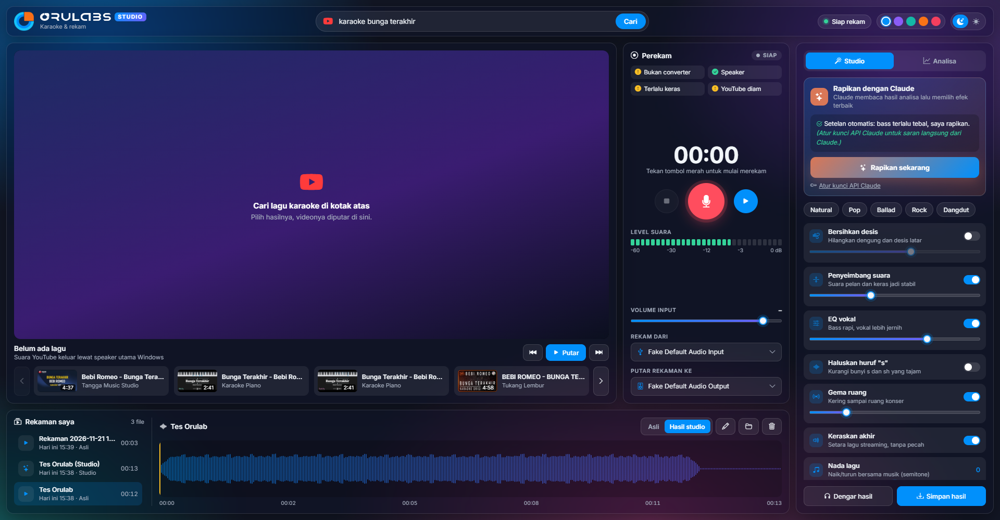
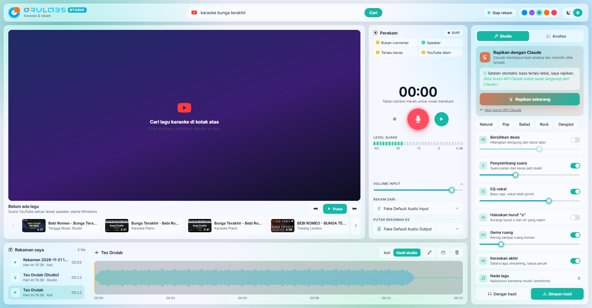

# Orulab Studio

Aplikasi karaoke + rekam untuk laptop Windows. Cari lagu karaoke di YouTube, bernyanyi lewat mixer,
rekam hasilnya, lalu rapikan dengan efek studio, semuanya dalam satu layar.



| Mode terang (warna Tosca) |
|---|
|  |

## Fitur

- **YouTube di dalam aplikasi**: cari lagu karaoke (tanpa akun atau kunci API) lalu putar langsung.
- **Perekam**: tombol rekam besar, timer, meter level hijau-kuning-merah, cek "Siap rekam", dan
  volume input Windows yang bisa diatur dari aplikasi.
- **Tersimpan otomatis** sebagai WAV di `Musik\Rekaman Karaoke` begitu tombol Stop ditekan.
- **Rekaman saya**: daftar rekaman, putar ulang, ganti nama, buka folder, hapus (ke Recycle Bin).
- **Gelombang suara**: klik untuk pindah posisi, seret pegangan kuning untuk memotong awal/akhir.
- **Studio**: Bersihkan desis, Penyeimbang suara (kompresor), EQ vokal, Haluskan huruf "s",
  Gema ruang, Keraskan akhir (setara lagu streaming tanpa pecah), dan Nada lagu (transpose).
  Ada preset Natural, Pop, Ballad, Rock, Dangdut, serta tombol **Asli / Hasil studio** untuk membandingkan.
- **Rapikan dengan Claude**: Claude membaca angka hasil analisa rekaman lalu memilih efek terbaik.
  Yang dikirim hanya angka analisa, bukan suara. Tanpa kunci API, aplikasi memakai setelan otomatis.
- **Analisa**: pecah atau tidak, bagian senyap, bass, kejelasan vokal, grafik keseimbangan nada,
  dan saran setelan mixer.
- **Tampilan glass** dari template Admin Panel Orulabs Limited Edition: 5 warna (Biru, Ungu, Tosca,
  Senja, Mawar), mode gelap/terang, pas satu layar di 1920×1080 dan responsif di layar kecil.

> Koreksi nada vokal (seperti autotune) belum bisa: musik dan vokal sudah tercampur di mixer,
> jadi nada vokal tidak bisa diubah tanpa ikut mengubah musik.

## Rangkaian

```
Laptop (YouTube) ──Bluetooth──► Mixer Luxsona ◄── Mic Advance (CH2)
                                   │        │
                          MAIN OUT │        │ REC (RCA merah-putih)
                                   ▼        ▼
                           Speaker Polytron  Kabel RCA ke jack 3,5
                                             ▼
                                   Splitter headset (lubang MIC)
                                             ▼
                                  Converter 3,5 ke Type-C ► Laptop (Orulab Studio)
```

- Bluetooth mixer disambungkan ke **laptop**, bukan ke HP. Tombol ST/MP3 di mixer pada posisi **MP3** (ditekan).
- Kabel REC wajib lewat **splitter headset** (lubang mic). Tanpa splitter, converter dan lubang 3,5 laptop
  tidak bisa membaca kabel stereo.

## Setelan yang dipakai

| Bagian | Setelan |
|---|---|
| Mixer CH2 (mic) | Gain 7, High +3 dB, Low −6 dB, HPF ditekan, Eff 3, Volume 7 |
| Mixer 3/4 (musik) | Gain 4, High 0, Low +3 dB, Volume 4, ST/MP3 = MP3 |
| Mixer master | Main 0 dB, Delay 3, Repeat 3, lampu CLIP jangan menyala |
| Polytron | Volume sesuai selera, Bass +1, Middle +2, Treble +1, Super bass dan Surround OFF |
| Laptop | Volume Windows (Bluetooth) 80%, YouTube 100%, Volume input converter 90% |

## Cara pakai

1. Ekstrak `Orulab-Studio.zip`, lalu jalankan **`Orulab Studio.exe`**. Aplikasi terbuka sebagai jendela
   Chrome (memakai profil Chrome Anda, jadi tidak perlu login YouTube lagi).
2. Pertama kali: klik **Izinkan** saat Chrome meminta akses mikrofon.
3. Cek "Rekam dari" = **Microphone (YA USB Audio)** (converter) dan status **Siap rekam** hijau.
4. Cari lagu, putar, bernyanyi, tekan tombol **merah** untuk merekam, tekan lagi untuk selesai.
5. Buka tab **Studio**, tekan **Rapikan sekarang**, dengarkan dengan **Dengar hasil**, lalu **Simpan hasil**.

Kunci API Claude (opsional) diatur lewat **Atur kunci API Claude**. Kunci disimpan terenkripsi dengan
akun Windows (DPAPI) di `%APPDATA%\OrulabStudio`.

## Build dari kode sumber

Tidak perlu Visual Studio. Compiler C# bawaan Windows (.NET Framework 4) sudah cukup.

```powershell
.\build.ps1
```

Hasilnya `dist\Orulab Studio\` (exe + folder `web`) dan `dist\Orulab-Studio.zip`.
Library Claude sudah dibundel di `web\vendor\claude.js`. Untuk membundel ulang (butuh Node.js):

```powershell
.\build.ps1 -BundelClaude
```

## Struktur

| Folder | Isi |
|---|---|
| `src/` | Server lokal C# (`localhost:47821`): file, rekaman, pencarian YouTube, volume input, pengaturan |
| `web/` | Tampilan: `index.html`, `app.css`, `app.js` (logika), `dsp.js` (analisa dan efek studio) |
| `web-src/` | Sumber modul Claude (`@anthropic-ai/sdk`) yang dibundel jadi `web/vendor/claude.js` |
| `docs/` | Screenshot dan mockup desain |

## Pihak ketiga

- [Bootstrap Icons](https://icons.getbootstrap.com/) (MIT) dan font [Inter](https://rsms.me/inter/) (SIL OFL 1.1), lisensi di `web/vendor/`.
- [Anthropic TypeScript SDK](https://github.com/anthropics/anthropic-sdk-typescript) (MIT), dibundel di `web/vendor/claude.js`.
- Video diputar dengan pemutar resmi YouTube (IFrame Player API).
- Logo dan template tampilan: Orulabs.
