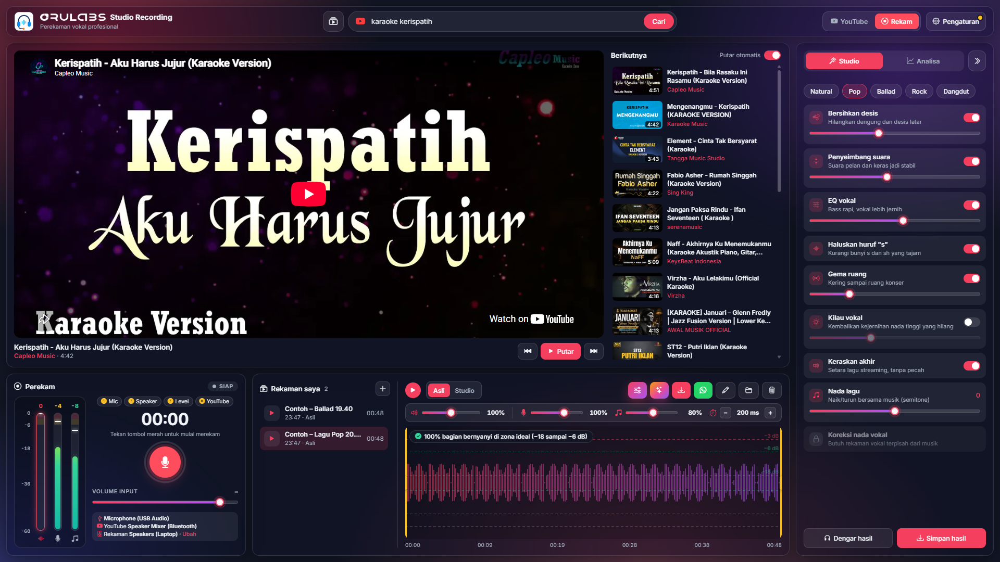
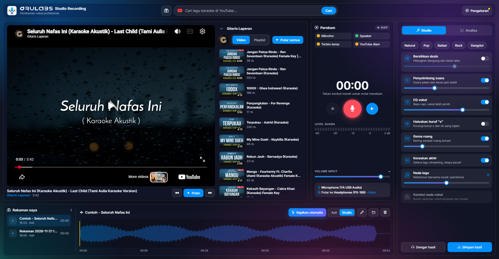
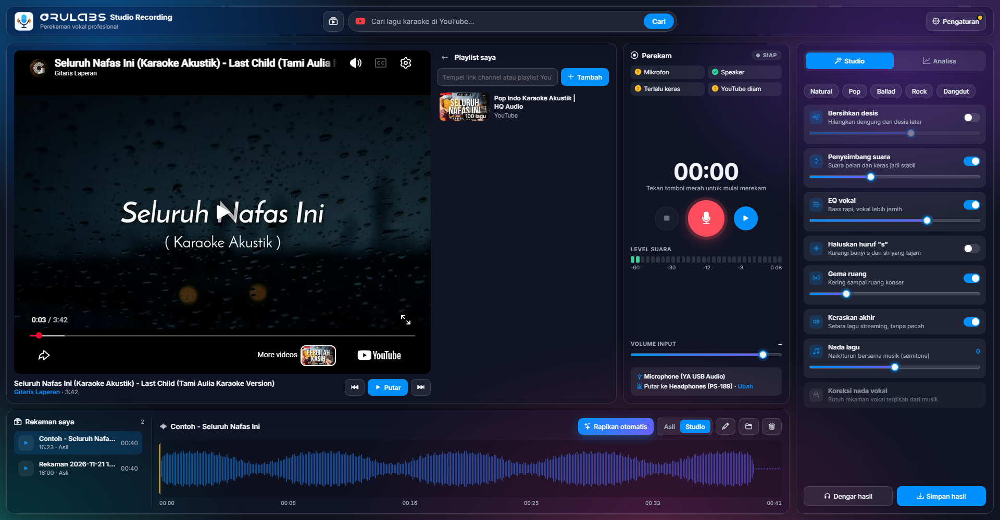
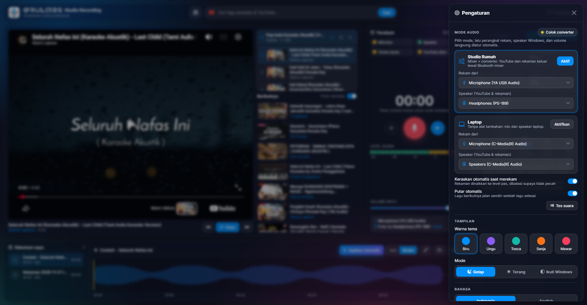
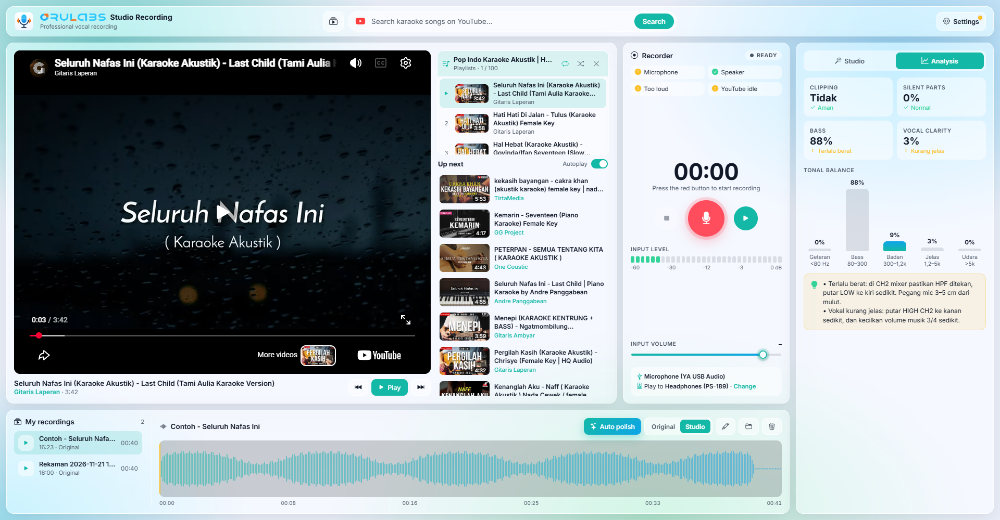
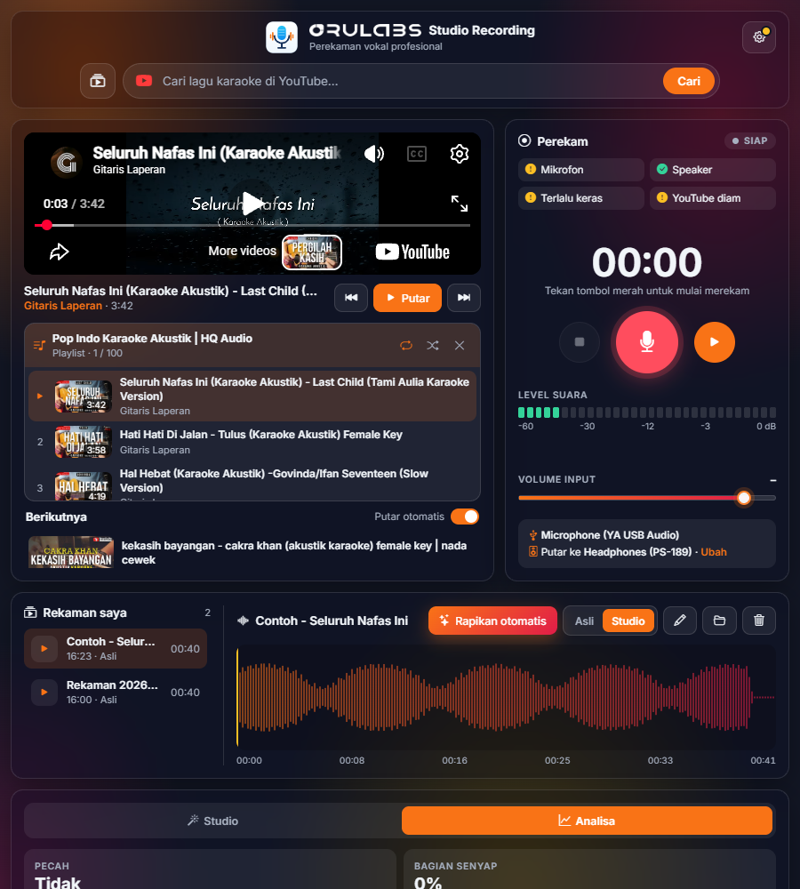

# Orulabs Studio Recording

Aplikasi perekaman vokal dan karaoke untuk laptop Windows. Cari dan putar lagu karaoke
dari YouTube, bernyanyi lewat mixer (atau langsung dari laptop), rekam hasilnya, lalu
rapikan dengan efek studio, semuanya dalam satu layar. Tersedia dalam Bahasa Indonesia
dan English.

## Fitur Utama

- **YouTube seperti aslinya**: video di kiri dan kolom **Berikutnya** di kanan, berisi saran
  dari YouTube sendiri, dengan **Putar otomatis**. Cari lagu tanpa akun atau kunci API, dan
  link video bisa langsung ditempel.
- **Channel**: klik nama channel untuk melihat semua video dan playlist-nya, plus tombol **Putar semua**.
- **Playlist saya**: tempel link channel YouTube Anda untuk mengambil semua playlist
  Publik/Tidak publik, atau tempel link satu playlist. Saat diputar, kotak playlist muncul di
  atas "Berikutnya", lengkap dengan Ulangi dan Acak.
- **Perekam**: tombol rekam besar, timer, meter level hijau-kuning-merah, cek kesiapan, dan
  volume input Windows langsung dari aplikasi.
- **Keraskan otomatis saat merekam**: rekaman dinaikkan ke level yang pas dan dibatasi
  supaya tidak pecah, tanpa membuat volume naik-turun mengikuti ketukan drum.
- **Rekam bersama YouTube**: tekan Rekam dan lagu ikut jalan, tekan Stop dan lagu ikut berhenti,
  lagu selesai maka rekaman ikut selesai. Rekaman otomatis dinamai sesuai judul lagu.
- **Rekam 2 jalur**: vokal direkam dari mic, musik YouTube direkam langsung dari laptop (digital,
  jernih). Sesudah merekam, atur volume **Vokal** dan **Musik** sendiri-sendiri, geser **Sinkron**
  bila speaker Bluetooth terlambat, lalu simpan sebagai satu lagu. Rekaman 1 jalur lama tetap bisa
  diatur lewat slider **Keseimbangan** (Musik ↔ Vokal).
- **Mode audio, sekali klik**:
  - **Studio Rumah**: mixer + converter, suara keluar lewat Bluetooth mixer.
  - **Laptop**: mic dan speaker laptop saja.
  Mode ini mengatur perangkat rekam, speaker bawaan Windows (YouTube ikut pindah), dan volume
  secara otomatis, dan langsung tersambung lagi setiap aplikasi dibuka. Speaker YouTube dan
  speaker untuk memutar rekaman bisa berbeda, misalnya karaoke lewat speaker mixer tapi hasil
  rekaman diputar di speaker laptop.
- **Riwayat pencarian**: pencarian terakhir muncul saat kotak cari diklik, tersaring saat mengetik,
  bisa dipilih dengan ↑/↓ + Enter, dan bisa dihapus satu-satu atau semuanya.
- **Rekaman saya**: tersimpan otomatis sebagai WAV, bisa diputar ulang, ganti nama, buka folder,
  atau dihapus ke Recycle Bin. Tombol **+** untuk **impor** rekaman lama dari HP atau aplikasi lain
  (WAV, MP3, M4A, OGG, FLAC): vokal saja, vokal + musik tercampur, atau vokal + file musik terpisah.
- **Kirim ke WhatsApp**: yang sedang didengar disimpan sebagai **M4A** (AAC 192 kbps, encoder bawaan
  Chrome) di folder `Untuk WhatsApp`, siap diseret ke chat.
- **Gelombang suara**: klik untuk pindah posisi, seret pegangan kuning untuk memotong awal/akhir.
- **Studio**: Bersihkan desis, Penyeimbang suara, EQ vokal, Haluskan huruf "s", Gema ruang,
  **Kilau vokal** (mengembalikan nada tinggi yang hilang, misalnya pada converter yang terpotong
  di 8 kHz), Keraskan akhir, dan Nada lagu. Ada preset Natural, Pop, Ballad, Rock, Dangdut, serta tombol
  **Asli / Studio** untuk membandingkan.
- **Mix Studio**: sekali klik, aplikasi membaca hasil analisa lalu menyeimbangkan EQ, volume, dan
  efek studio sendiri, dengan 3 pilihan hasil (Natural, Video klip, Hangat).
- **✨ Magic Vocal** (rekaman 2 jalur): kunci lagu dibaca otomatis dari jalur musik, nada vokal yang
  fals dirapikan ke nada yang benar (koreksi nada / pitch correction), dinamika vokal disetarakan,
  lalu rantai vokal studio dan mastering. Tiga tingkat: Natural, Pop, dan Efek Autotune. Hasilnya
  terlihat di **Grafik nada vokal** pada tab Analisa.
- Semua pengolahan dikerjakan di laptop, tanpa internet dan tanpa API.
- **Analisa**: pecah atau tidak, bagian senyap, bass, kejelasan vokal, grafik nada, dan saran setelan mixer.
- **Pengaturan**: mode audio dan status perangkat, tes suara, keraskan otomatis, putar otomatis,
  5 warna tema (Biru, Ungu, Tosca, Senja, Mawar), mode Gelap/Terang/Ikuti Windows, bahasa, folder
  rekaman, dan versi aplikasi.
- **Update otomatis**: aplikasi mengecek rilis baru di GitHub setiap dibuka. Bisa juga dicek manual
  lewat tombol **Cek update** di Pengaturan, lalu **Update sekarang**: aplikasi memperbarui diri dan
  terbuka lagi sendiri.
- **Tampilan glass Orulabs**: pas satu layar di 1920×1080 dan responsif di layar kecil, dengan
  logo dan kotak cari otomatis ke tengah.

## Screenshot

| Tampilan utama (playlist + berikutnya) | Halaman channel |
|---|---|
|  |  |

| Playlist saya | Pengaturan |
|---|---|
|  |  |

| English + mode terang | Layar kecil |
|---|---|
|  |  |

> Rekaman pada screenshot adalah contoh (suara sintetis), bukan rekaman sungguhan.

## Rangkaian Studio Rumah

```
Laptop (YouTube) ──Bluetooth──► Mixer ◄── Mic (CH2)
                                 │     │
                        MAIN OUT │     │ REC (RCA merah-putih)
                                 ▼     ▼
                            Speaker   Kabel RCA ke jack 3,5
                                       ▼
                             Splitter headset (lubang MIC)
                                       ▼
                       Converter 3,5 ke Type-C ► Laptop (Orulabs Studio Recording)
```

- Tombol ST/MP3 di mixer pada posisi **MP3** (ditekan) supaya suara Bluetooth masuk.
- Kabel REC wajib lewat **splitter headset** (lubang mic). Tanpa splitter, converter dan lubang
  3,5 laptop tidak bisa membaca kabel stereo dari mixer.

| Bagian | Setelan yang dipakai |
|---|---|
| Mixer CH2 (mic) | Gain 7, High +3 dB, Low −6 dB, HPF ditekan, Eff 3, Volume 7 |
| Mixer 3/4 (musik) | Gain 4, High 0, Low +3 dB, Volume 4, ST/MP3 = MP3 |
| Mixer master | Main 0 dB, Delay 3, Repeat 3, lampu CLIP jangan menyala |
| Speaker | Volume sesuai selera, Bass +1, Middle +2, Treble +1, Super bass dan Surround OFF |
| Laptop | Volume input converter 90% (diatur otomatis oleh mode Studio Rumah) |

## Teknologi

- **Server lokal C# (.NET Framework 4.8)** di `localhost:47821`. Di-compile dengan compiler bawaan
  Windows, tanpa Visual Studio. Tugasnya: file rekaman, pencarian YouTube, volume input, dan
  perangkat audio bawaan (Windows Core Audio).
- **Tampilan HTML/CSS/JavaScript** dibuka sebagai jendela aplikasi Chrome. Perekaman memakai
  Web Audio API (AudioWorklet), efek studio memakai OfflineAudioContext + DSP sendiri, dan video
  memakai pemutar resmi YouTube (IFrame Player API).
- **Inno Setup 6** untuk installer per user (tanpa hak admin).
- Font [Inter](https://rsms.me/inter/) dan [Bootstrap Icons](https://icons.getbootstrap.com/),
  disimpan lokal di `web/vendor/`. Tema diadaptasi dari Admin Panel Orulabs Limited Edition (skin glass).

---

## Instalasi (pengguna)

1. Unduh `Orulabs-Studio-Recording-Setup-<versi>.exe` dari halaman
   [Releases](https://github.com/r0corp/Orulabs_Studio_Recording/releases/latest), lalu jalankan.
   - Tidak perlu hak admin. Aplikasi dipasang per user di `%LOCALAPPDATA%\Programs\Orulabs Studio Recording`.
   - Shortcut dibuat di Start Menu dan Desktop.
2. Buka **Orulabs Studio Recording**. Aplikasi terbuka sebagai jendela Chrome memakai profil Chrome
   Anda, jadi tidak perlu login YouTube lagi.
3. Pertama kali: klik **Izinkan** saat Chrome meminta akses mikrofon.
4. Buka **Pengaturan → Mode audio**, cek perangkat tiap mode, lalu tekan **Aktifkan** dan **Tes suara**.

Setelah terpasang, update berikutnya datang sendiri. Lihat **Pengaturan → Cek update**.

Data aplikasi:

| Data | Lokasi |
|---|---|
| Rekaman (WAV) | `Musik\Rekaman Karaoke` |
| Pengaturan, Playlist saya | `%APPDATA%\OrulabStudio\` |

## Build dari kode sumber

### 1. Prasyarat

- Windows 10/11 dengan .NET Framework 4.8 (sudah bawaan Windows).
- Google Chrome (atau Microsoft Edge).
- [Inno Setup 6](https://jrsoftware.org/isinfo.php), untuk membuat installer.

### 2. Clone repository

```bash
git clone https://github.com/r0corp/Orulabs_Studio_Recording.git
cd Orulabs_Studio_Recording
```

### 3. Build

```powershell
.\build.ps1
```

Hasilnya ada di `dist\`:

- `Orulabs Studio Recording\`: exe + folder `web`
- `Orulabs-Studio-Recording.zip`: dipakai update otomatis
- `Orulabs-Studio-Recording-Setup-<versi>.exe`: installer

Untuk sekalian memasang atau memperbarui aplikasi di laptop ini:

```powershell
.\build.ps1 -Pasang
```

### 4. Rilis

1. Naikkan `Versi` di `src/Server.cs`.
2. Jalankan `.\build.ps1`.
3. Buat rilis GitHub dengan tag `v<versi>`, lalu lampirkan `Orulabs-Studio-Recording.zip` dan
   `Orulabs-Studio-Recording-Setup-<versi>.exe`. Aplikasi yang sudah terpasang memakai file
   `.zip` untuk update otomatis.

## Struktur

| Folder / file | Isi |
|---|---|
| `src/Server.cs` | Server lokal: rute API, YouTube (cari, berikutnya, channel, playlist), file rekaman, pengaturan |
| `src/Audio.cs` | Volume input dan perangkat audio bawaan Windows (Core Audio) |
| `src/Updater.cs` | Update otomatis dari GitHub Releases |
| `installer.iss` | Installer Inno Setup |
| `web/index.html`, `web/app.css` | Tampilan |
| `web/app.js` | Logika: YouTube, perekam, rekaman, studio, analisa, mode audio, pengaturan |
| `web/dsp.js` | Analisa rekaman, efek studio, WAV |
| `web/i18n.js` | Kamus Bahasa Indonesia dan English |
| `docs/` | Screenshot dan mockup desain |

## Catatan

- Playlist YouTube **Pribadi**, "Tonton nanti", "Video yang disukai", dan riwayat tonton tidak bisa
  dibaca tanpa login Google. Ubah playlist ke **Tidak publik** supaya tetap tersembunyi tapi bisa dibuka.
- Saran "Berikutnya" diambil tanpa login, jadi tidak dipersonalisasi ke akun Anda.
- Koreksi nada vokal (autotune) belum bisa: musik dan vokal sudah tercampur di mixer.
